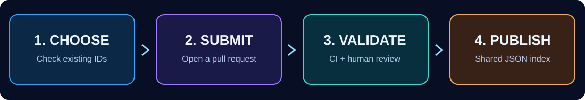

<div align="center">

# PHIP-0001
### Unique Homebrew Identity · Open community draft

**A shared identity layer for PS5 homebrew, built for developers, maintainers, stores, and installers.**


[](https://github.com/Yahballon/PHIP-0001/actions/workflows/validate.yml)
[](docs/PHIP-0001.md)
[](REGISTRY.md)
[](CONTRIBUTING.md)

[**Register an app**](CONTRIBUTING.md#register-an-application) ·
[**Browse registry**](REGISTRY.md) ·
[**Read the specification**](docs/PHIP-0001.md) ·
[**API / data**](docs/INTEGRATION.md)

</div>

---

## The problem

A native PS5 homebrew app commonly installs to a directory named after its PS5 Title ID, such as `/data/homebrew/PPSA99873/`. If unrelated apps choose the same Title ID, one can overwrite or be mistaken for the other. Different stores may disagree about identity and ownership.

**PHIP-0001 proposes a transparent, community-managed registry** that binds one unique `title_id` to one durable global `app_id` and a documented publisher repository. It does **not** change PlayStation firmware, reserve IDs with Sony, or guarantee that applications outside participating registries cannot collide.

## Why participate?

| For developers | For stores and installers | For maintainers |
| --- | --- | --- |
| Publicly document an app identity | Use consistent title IDs and metadata | Review changes in public |
| Catch accidental duplicate IDs | Compare publishers before overwriting | Automated schema and collision checks |
| Keep IDs stable between releases | Consume a simple read-only JSON index | Reproducible deterministic index |

## A four-step workflow



1. **Choose** a Title ID and check both [this registry](REGISTRY.md) and [the existing PS5 homebrew catalog](https://github.com/blackbearreloaded/ps5-homebrew-catalog/tree/main/apps).
2. **Submit** one `registry/PPSAxxxxx.json` file in a pull request opened from your GitHub account.
3. **Validate** syntax, uniqueness, namespace consistency, and changes to immutable identity fields. Maintainers review ownership and external conflicts.
4. **Publish** approved records in `index/registry.json` for any store or tool to read.

## Your first registration

Use this **illustrative example only** (the example's ID is *not* reserved):

```json
{
  "schema_version": "1.0",
  "title_id": "PPSA12345",
  "app_id": "io.github.exampledev.example-app",
  "name": "Example Homebrew App",
  "developer": "Example Developer",
  "owner": "exampledev",
  "source_repo": "https://github.com/exampledev/example-app",
  "status": "reserved",
  "created": "2026-10-13"
}
```

A real existing project, **Payload LauncherX**, is included under [PPSA99873](registry/PPSA99873.json) as an initial entry. This is a PHIP-local record; it does not assert a reservation at Sony or another project's registry.

### Registration requirements

- Use the PS5 native homebrew Title ID form **`PPSA` + five digits**; do not copy `PPSA99999`, a common boilerplate placeholder.
- Select a durable global name: `io.github.<owner>.<slug>`; the namespace must match your GitHub owner.
- Publish one JSON record named exactly `registry/<TITLE_ID>.json`.
- Open a pull request from the GitHub owner account, or request a manual ownership transfer review.
- **Do not change** an approved application's Title ID, global ID, owner, or source URL without an explicit migration/transfer review.
- Treat `reserved` as a planned app and `registered` as an existing project, not as proof of safety or compatibility.

See [CONTRIBUTING.md](CONTRIBUTING.md) and the [full normative draft](docs/PHIP-0001.md).

## Integrate the registry

The approved records are served directly as versioned GitHub raw content:

```text
https://raw.githubusercontent.com/Yahballon/PHIP-0001/main/index/registry.json
https://raw.githubusercontent.com/Yahballon/PHIP-0001/main/index/stats.json
```

Example (Python, standard library):

```python
import json
from urllib.request import urlopen

url = "https://raw.githubusercontent.com/Yahballon/PHIP-0001/main/index/registry.json"
with urlopen(url, timeout=10) as response:
    index = json.load(response)
assert index["schema_version"] == "1.0"
for app in index["apps"]:
    print(app["title_id"], app["app_id"], app["name"])
```

For reliable or security-sensitive consumers, **pin a reviewed commit**, use HTTPS, and decide whether to trust this repository as a registry authority. A registry listing is not a binary signature or an executable safety assessment.

## Project map

```text
PHIP-0001/
├── README.md                    # Overview
├── docs/
│   ├── PHIP-0001.md             # Normative proposal
│   ├── INTEGRATION.md           # Store and tooling integration
│   └── SECURITY.md              # Threat model and limitations
├── registry/PPSA99873.json      # Approved example: real app
├── schemas/registration.schema.json
├── examples/                    # Non-registered sample app
├── tools/
│   ├── validate_registry.py
│   └── build_index.py
├── index/
│   ├── registry.json            # Machine-readable combined registry
│   └── stats.json
├── tests/
├── assets/                      # Original unbranded visuals
└── .github/workflows/           # CI checks and index publication
```

## Join the conversation

PHIP means **PlayStation Homebrew Improvement Proposal**, a proposed community convention, not an official or Sony-affiliated standards body. This draft invites interoperability with existing community catalogs, especially [blackbearreloaded/ps5-homebrew-catalog](https://github.com/blackbearreloaded/ps5-homebrew-catalog), rather than asserting an exclusive authority.

Review the [design](docs/PHIP-0001.md), [report an identity conflict](https://github.com/Yahballon/PHIP-0001/issues/new/choose), or [open a pull request](https://github.com/Yahballon/PHIP-0001/pulls).

<div align="center"><strong>One app. One identity. A stronger homebrew community.</strong></div>
